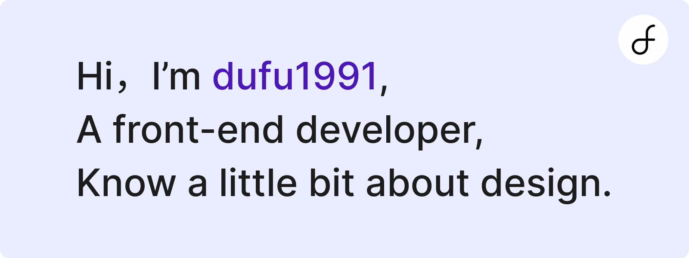
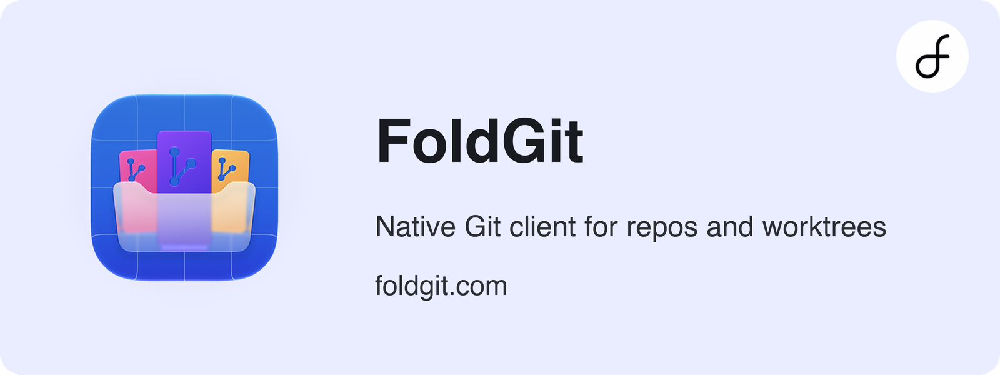
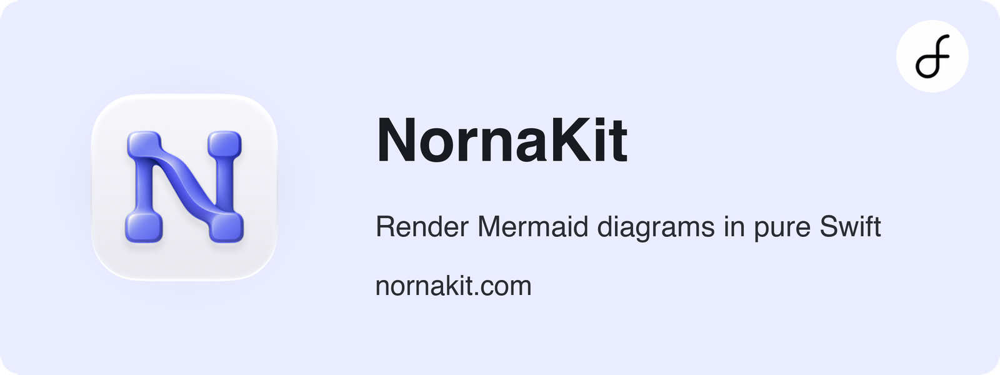
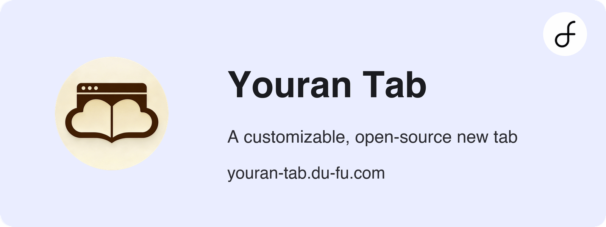
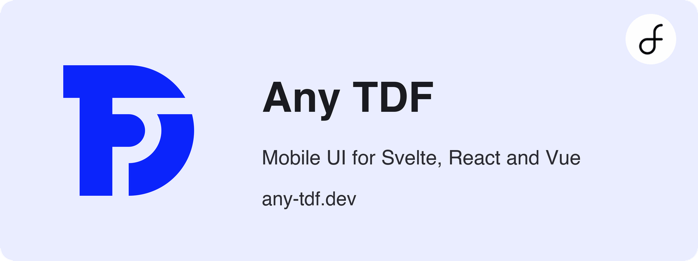

### About

  <a href="https://github.com/dufu1991">
    <picture>
      <source media="(prefers-color-scheme: dark)" srcset="./images/dufu-dark.png">
      
    </picture>
  </a>

### Works

  <a href="https://foldgit.com">
    <picture>
      <source media="(prefers-color-scheme: dark)" srcset="./images/foldgit-dark.png">
      
    </picture>
  </a>
  <a href="https://nornakit.com">
    <picture>
      <source media="(prefers-color-scheme: dark)" srcset="./images/nornakit-dark.png">
      
    </picture>
  </a>

  <a href="https://youran-tab.du-fu.com">
    <picture>
      <source media="(prefers-color-scheme: dark)" srcset="./images/youran-tab-dark.png">
      
    </picture>
  </a>
  <a href="https://youran-toolbox.du-fu.com">
    <picture>
      <source media="(prefers-color-scheme: dark)" srcset="./images/youran-toolbox-dark.png">
      
    </picture>
  </a>

  <a href="https://any-tdf.dev">
    <picture>
      <source media="(prefers-color-scheme: dark)" srcset="./images/any-tdf-dark.png">
      
    </picture>
  </a>
  <a href="https://github.com/dufu1991/simple-cloud-music">
    <picture>
      <source media="(prefers-color-scheme: dark)" srcset="./images/scm-dark.png">
      
    </picture>
  </a>

### Activities

  <a href="https://github.com/dufu1991">
    <picture>
      <source media="(prefers-color-scheme: dark)" srcset="https://github-profile-summary-cards.vercel.app/api/cards/profile-details?username=dufu1991&theme=github_dark">
      
    </picture>
  </a>

### Skills

  <a href="https://github.com/dufu1991">
    <picture>
      <source media="(prefers-color-scheme: dark)" srcset="https://skillicons.dev/icons?i=js%2Ctypescript%2Chtml%2Ccss%2Csvelte%2Cvue%2Creact%2Ctailwind%2Cswift%2Crust%2Ccs%2Cdotnet%2Ctauri%2Cvite%2Crollupjs%2Cwebpack%2Cbun%2Cnpm%2Cgit%2Cgithub%2Cgithubactions%2Ccloudflare%2Cpy%2Cvscode%2Cmd%2Cwordpress%2Cps%2Cai%2Cfigma%2Cblender&amp;theme=dark&amp;perline=15">
      
    </picture>
  </a>

### Records

  <a href="https://github.com/dufu1991">
    <picture>
      <source media="(prefers-color-scheme: dark)" srcset="https://raw.githubusercontent.com/dufu1991/dufu1991/output/github-contribution-grid-snake-dark.svg">
      
    </picture>
  </a>

